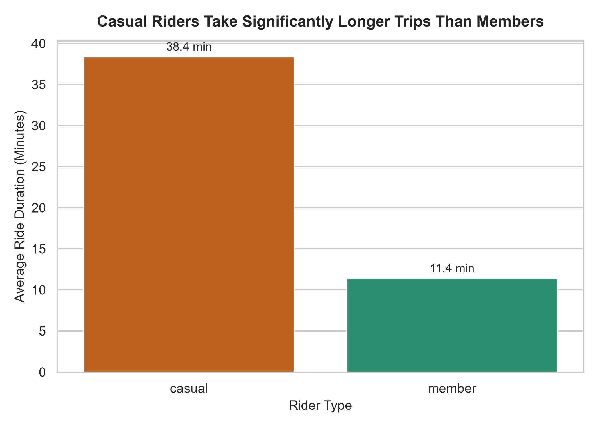
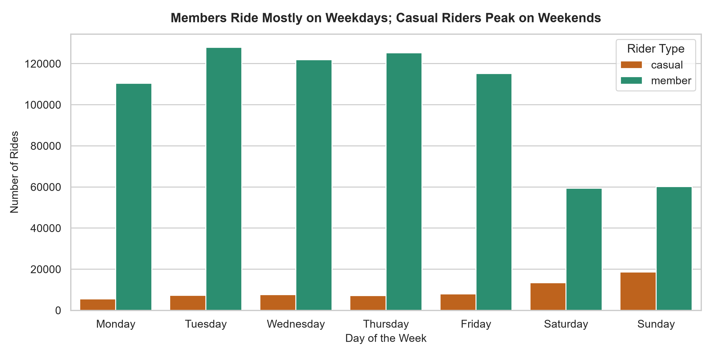
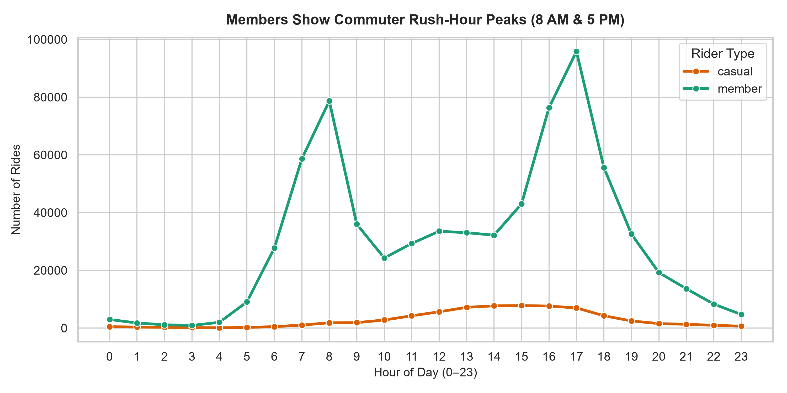
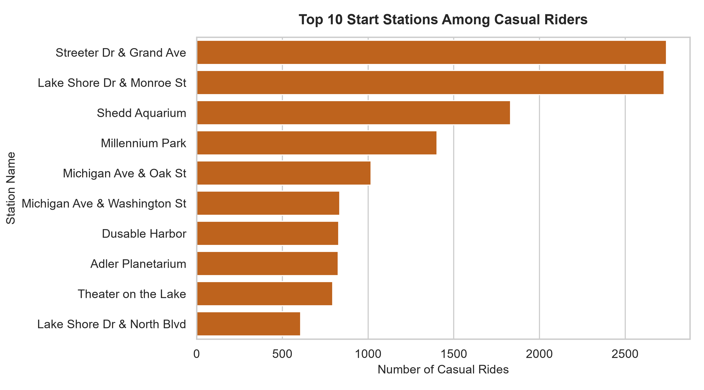

# Cyclistic Bike-Share Analysis (Python Case Study)

## 1. Business Task
**Cyclistic**, a Chicago bike-share program, wants to maximize future growth by converting **casual riders** (single-ride and full-day pass users) into profitable **annual members**.

**Core Question:** *How do annual members and casual riders use Cyclistic bikes differently?*

**Key Stakeholders:** Lily Moreno (Director of Marketing), Cyclistic Marketing Analytics Team, and the Cyclistic Executive Team.

---

## 2. Data Sources & Limitations
* **Dataset:** Historical Q1 trip data from Divvy (`Divvy_Trips_2019_Q1` and `Divvy_Trips_2020_Q1`), provided publicly by Motivate International Inc. under the Divvy Data License Agreement.
* **Data Integrity (ROCCC):** Reliable, Original, Comprehensive, Cited, and historical Q1 snapshots suitable for seasonal behavioral comparison.
* **Privacy Limitation:** Personally identifiable information (PII) such as credit card numbers or home addresses is excluded, so individual casual riders cannot be tracked across multiple single-pass purchases.

---

## 3. Data Cleaning & Preparation (Python)
Using `pandas` in `cyclistic_analysis.ipynb`, the two quarterly datasets were standardized, merged, and audited:
* **Schema Alignment:** Renamed 2019 columns (`trip_id`, `usertype`, etc.) to match 2020 columns (`ride_id`, `member_casual`, etc.) and unified user labels (`Subscriber` → `member`, `Customer` → `casual`).
* **Initial Combined Rows:** `791,956` (`365,069` from 2019 Q1 + `426,887` from 2020 Q1).
* **Records Removed (`4,249` rows):**
  * `3,767` maintenance/test rides from station `"HQ QR"`
  * `210` rides with zero or negative duration (`<= 0` min)
  * `482` extreme outliers lasting over 24 hours (`> 1,440` min)
  * `0` duplicate `ride_id` entries found
* **Final Cleaned Dataset:** **`787,707` valid trips**
* **Feature Engineering:** Calculated `ride_length_min`, `day_of_week` (Monday–Sunday), `hour` (0–23), and `year_month`.

---

## 4. Analysis & Key Findings

### Overall Rider Comparison
| Rider Type | Total Rides | Share (%) | Mean Duration (min) | Median Duration (min) |
| :--- | :---: | :---: | :---: | :---: |
| **Member** | 720,125 | 91.42% | 11.41 | 8.47 |
| **Casual** | 67,582 | 8.58% | 38.38 | 23.13 |

### Key Behavioral Insights
1. **Casual Riders Take Over 3x Longer Trips:** Casual rides average **38.4 minutes** (median 23.1 min), compared to **11.4 minutes** (median 8.5 min) for annual members—indicating leisure and sightseeing vs. short point-to-point commutes.

2. **Members Commute on Weekdays; Casual Riders Surge on Weekends:** Member volume peaks mid-week (Tuesday: **127,946 rides**) and drops nearly in half on weekends. In contrast, **47.3% of all casual rides** occur on Saturday (**13,416**) and Sunday (**18,578**—more than 3x Monday's volume of 5,569).

3. **Distinct Time-of-Day Patterns:** Members show sharp bimodal commuter spikes at **8:00 AM** and **5:00 PM**, while casual rides follow a single smooth curve peaking during mid-afternoon leisure hours (**1:00 PM – 4:00 PM**).

4. **Leisure & Waterfront Hotspots:** Top casual start stations cluster heavily around major tourist, park, and lakefront destinations—led by *Streeter Dr & Grand Ave*, *Lake Shore Dr & Monroe St*, *Shedd Aquarium*, and *Millennium Park*.

---

## 5. Top 3 Recommendations
1. **Launch a "Weekend & Leisure Pass" Membership Tier:** Since **47.3%** of casual rides take place on Saturday and Sunday and last ~38 minutes on average, introduce a lower-cost weekend/seasonal pass or a discounted "starter" annual membership that bridges single-day leisure users into recurring members.
2. **Geo-Targeted Promotions at Top Waterfront Stations:** Focus QR-code signage, bike-rack ads, and pop-up promotions at the top casual hubs (*Streeter Dr & Grand Ave*, *Lake Shore Dr & Monroe St*, *Shedd Aquarium*, and *Millennium Park*) during peak weekend afternoons (1 PM – 4 PM).
3. **In-App Savings Calculator & Ride-Length Triggers:** Use digital media and Cyclistic app notifications to target casual riders after rides longer than 30 minutes or after multiple weekend trips, showing exactly how much money they would save by switching to an annual membership.

---

## 6. Repository Structure
* `cyclistic_analysis.ipynb` — Complete Python notebook (cleaning, analysis, visualizations)
* `data_clean/` — Aggregated summary CSV files exported for reporting
* `images/` — Exported high-resolution charts (`300 DPI`)